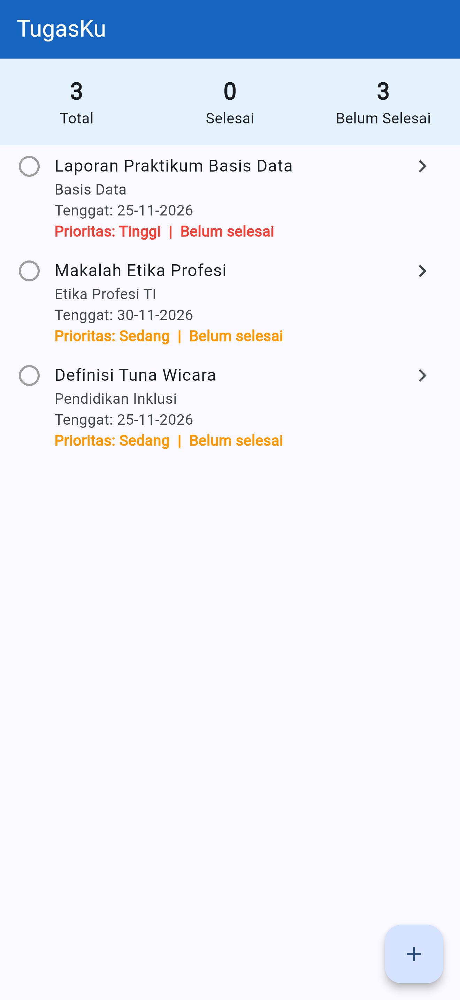
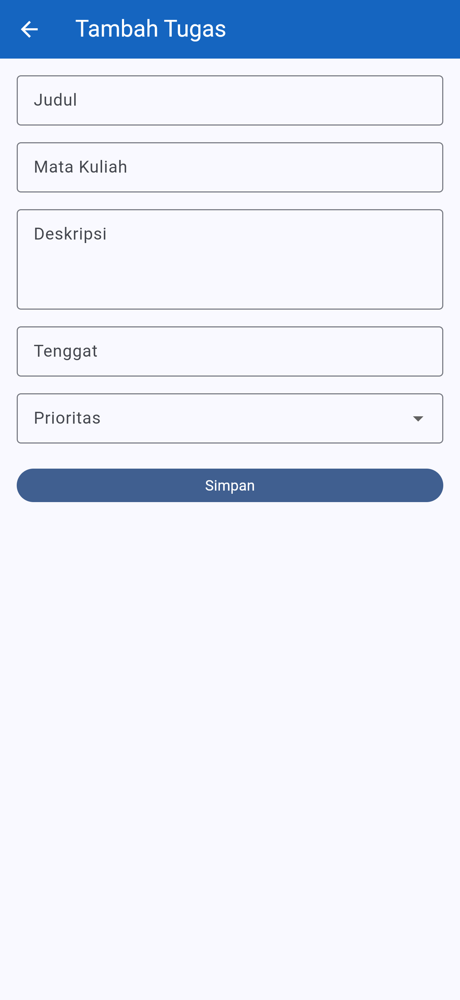
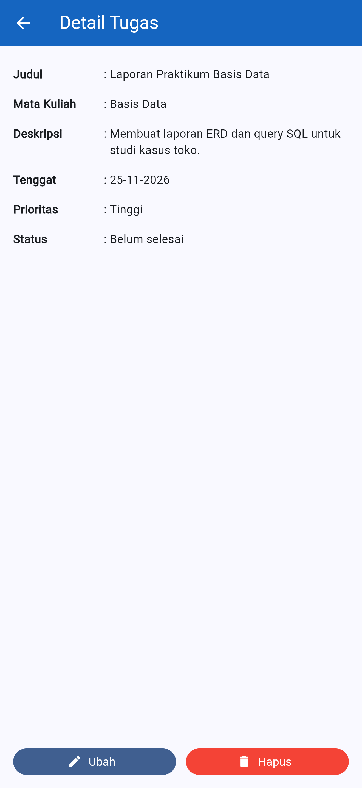
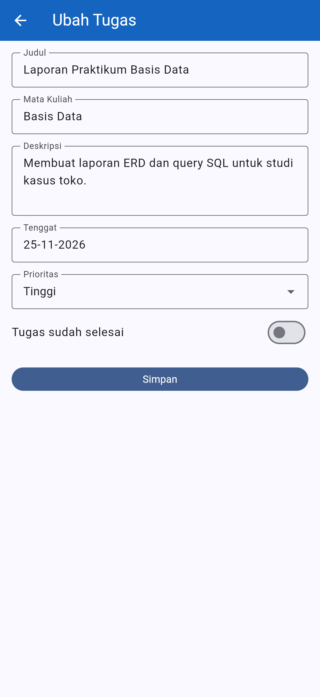
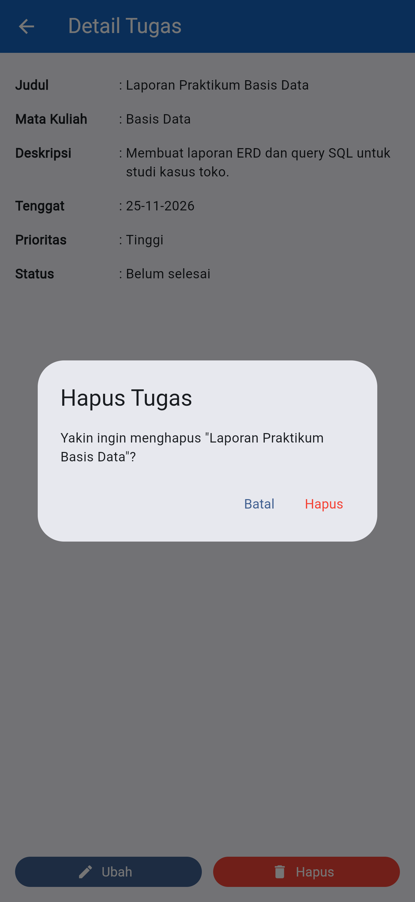
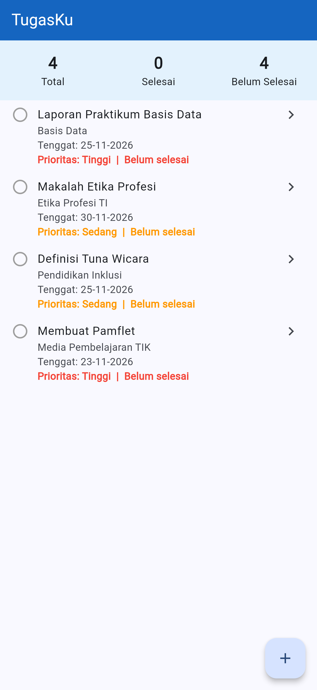
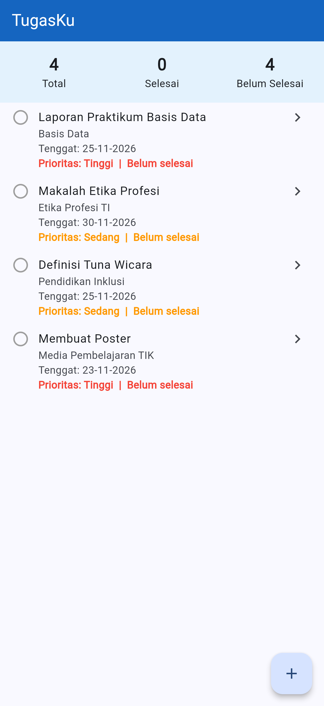
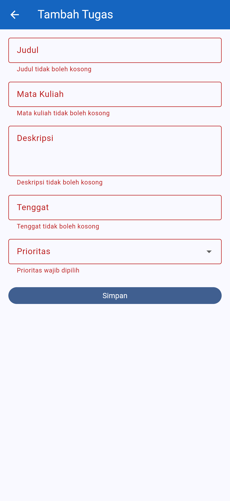

# TugasKu - Aplikasi Pencatat Tugas dan Tenggat Kuliah

Aplikasi mobile Android berbasis Flutter untuk mencatat, melihat, mengubah, dan menghapus tugas kuliah beserta tenggatnya. Data disimpan sementara di memori (List).

## Pengembang
- Nama :Muhamad Rizal Rivardi
- NIM  : C2483207007
- Program Studi : Pendidikan Teknologi Informasi, Universitas Muhammadiyah Tasikmalaya
- Mata Kuliah : Pemrograman Mobile (Dosen: Alamsyah Firdaus, M.Kom.)

## Teknologi
- Flutter 3.146.0 dan Dart 3.146.0
- Tanpa package tambahan di luar Flutter SDK

## Fitur
- Daftar tugas dengan ringkasan (total, selesai, belum selesai)
- Tambah tugas dengan validasi form
- Detail tugas
- Ubah tugas dan status selesai
- Hapus tugas dengan konfirmasi
- Tiga data contoh awal

## Cara Menjalankan
1. Pastikan Flutter SDK terpasang (`flutter doctor`)
2. Clone repository: `git clone [URL REPOSITORY]`
3. Masuk ke folder proyek: `cd [NAMA FOLDER]`
4. Unduh dependensi: `flutter pub get`
5. Jalankan di emulator atau HP Android: `flutter run`

## Screenshot

